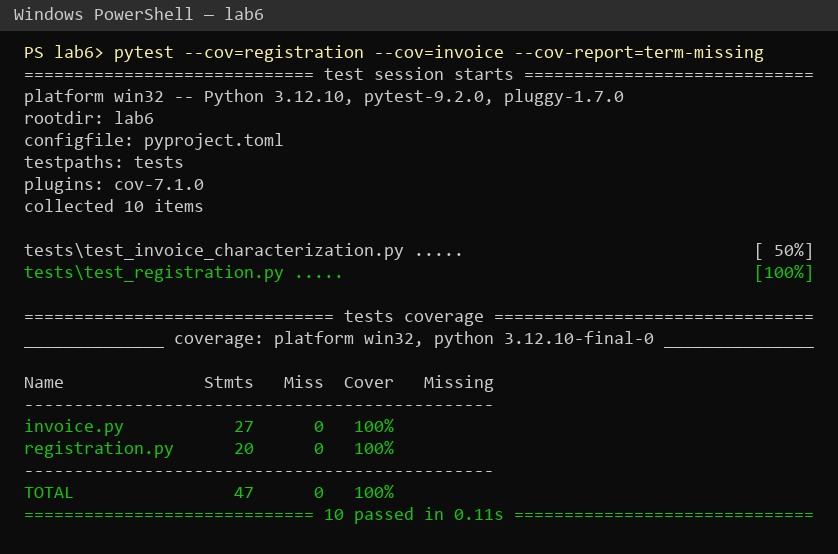

# Lab 6 — TDD, Coverage and BDD

**Team 22 · Cafeteria Pre-Order App · SET 312**
Code: [`lab6/`](../../lab6) · Reports: this folder.

| Deliverable | File |
|---|---|
| Git log, one commit per TDD step (Red → Green → Refactor) | [`git-log.txt`](git-log.txt) |
| Coverage report at 100 % (Task A1) | [`coverage-100.png`](coverage-100.png), [`coverage-output.txt`](coverage-output.txt) |
| `registration.feature` with the drop scenario (Task B1) | [`lab6/features/registration.feature`](../../lab6/features/registration.feature), [`behave-output.txt`](behave-output.txt) |
| Smells table (Task C1) and `SiblingPolicy` (Task C2) | [`smells.md`](smells.md), [`lab6/invoice.py`](../../lab6/invoice.py) |
| Three Gherkin scenarios for our team story (Part D) | [`team-story.feature`](team-story.feature) |

## Task A1 — Coverage



The last uncovered line was the error branch in `Student.drop`; the test `test_cannot_drop_course_that_is_not_registered` (TDD cycle 5) brings `registration.py` and `invoice.py` to 100 %.

**Answer:** No — 100 % coverage only proves that every line ran during the tests, not that the code is correct, because a test can run a line without checking the right result or can miss a case nobody thought of.

## Task B1 — Behave

`behave` runs **8 scenarios, 32 steps, all passed** (full output in `behave-output.txt`). The two new scenarios are *Drop a registered course* and *Refuse to drop a course that is not registered*.

## How to run

```
cd lab6
python -m venv .venv
.venv\Scripts\activate
pip install pytest pytest-cov behave ruff
pytest --cov=registration --cov=invoice --cov-report=term-missing
behave
ruff check .
```
